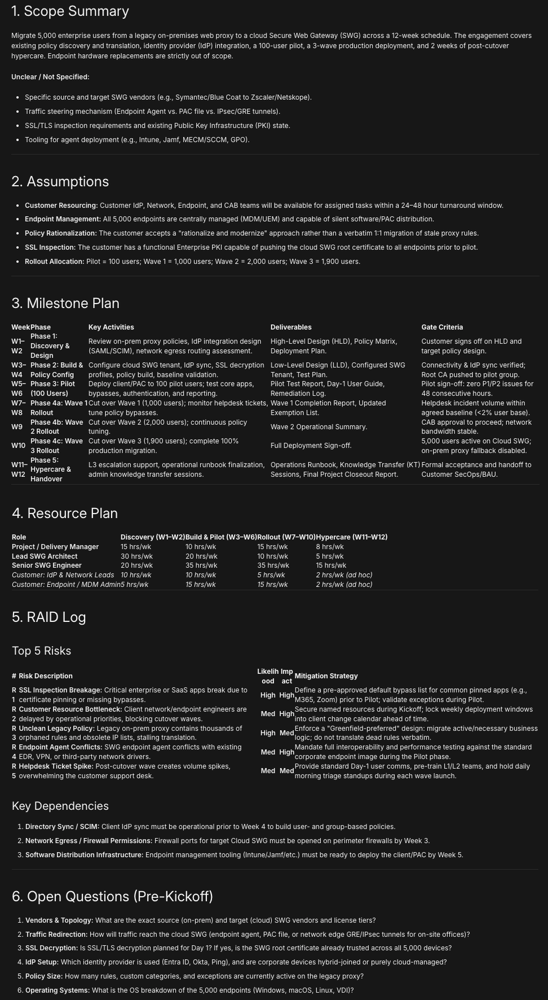
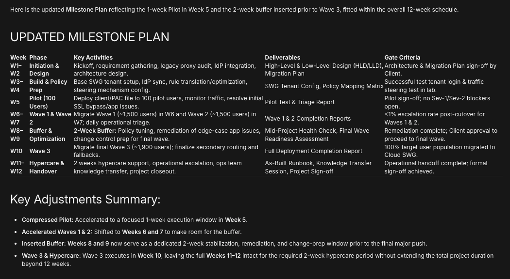

# SOW to Delivery Plan Agent

An AI agent built in n8n that turns a Statement of Work (SOW) into a structured delivery plan, then revises that plan when you ask for changes.

Built as a hands-on project to practise AI agent design from a delivery management point of view. All data in this repo is fictitious.

## What it produces

Paste a SOW into the chat and the agent returns:

1. Scope summary, including anything unclear
2. Assumptions
3. Milestone plan (week, phase, key activities, deliverables, gate criteria)
4. Resource plan (roles and rough effort per phase)
5. RAID log (top 5 risks with impact, likelihood and mitigation, plus key dependencies)
6. Open questions to ask the client before kickoff

If the SOW is missing information, the agent states an assumption instead of inventing facts.

## How it works

```
Chat trigger -> AI Agent -> Google Gemini chat model
                         -> Simple Memory (keeps the conversation)
```

- **Chat trigger:** receives the pasted SOW.
- **AI Agent:** a system prompt sets the role (senior delivery manager at a cybersecurity professional services firm) and the six-part output format.
- **Gemini chat model:** generates the plan. Retry on fail is enabled because free-tier models can be busy.
- **Simple Memory:** lets you follow up, for example "Move the pilot to Week 5 and add a 2-week buffer before Wave 3", and get a revised plan instead of a fresh one.

## Demo

**Fictitious SOW used for testing:**

> Migrate 5,000 users from an on-prem web proxy to a cloud SWG over 12 weeks. Customer provides IdP access and network team support. Includes policy migration, pilot with 100 users, 3 rollout waves, and 2 weeks of hypercare. Out of scope: endpoint hardware changes.

**Follow-up used to test memory:**

> Move the pilot to Week 5 and add a 2-week buffer before Wave 3. Update the milestone plan.

The agent returned an updated milestone plan with the pilot in Week 5, a 2-week stabilisation buffer, and Wave 3 in Week 10, still within the 12-week schedule.





## Run it yourself

1. Install Node.js (n8n needs version 20.19 to 24.x).
2. Start n8n:
   ```
   npx n8n
   ```
3. Open `http://localhost:5678` and create a local owner account.
4. Create a free Gemini API key at [Google AI Studio](https://aistudio.google.com).
5. In n8n, import `SOW_to_Delivery_Plan_Agent.json` (workflow menu, then Import from file).
6. Open the Google Gemini Chat Model node, create a new credential, and paste your own API key.
7. Choose an available Gemini Flash model, save, and chat.

## Notes

- No API keys or credentials are stored in this repo. The workflow file only references a credential name.
- Model availability and free-tier capacity change often. If a model is busy or closed to new users, pick another Flash or Flash-Lite model in the Gemini node.
- Use fictitious or non-confidential SOWs only.

## Possible next steps

- Output the plan to a Google Sheet or a project tool
- Add a tool that checks the plan for missing sections
- Add evaluation test cases with several sample SOWs

Built by Nitin Rawal.
